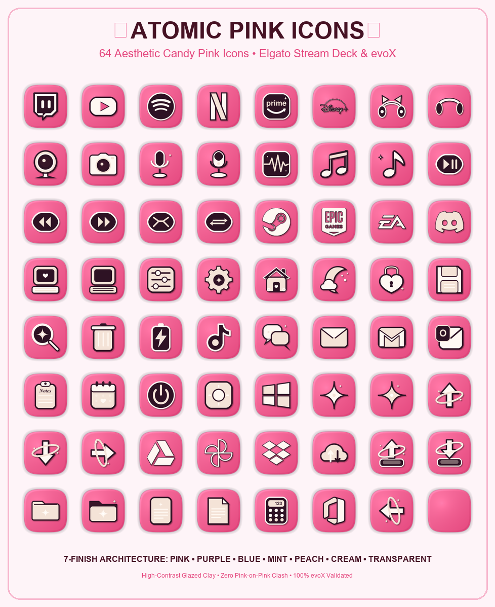

  
  <h1>Pink & Purple & Blue & Mint & Peach Icon Packs</h1>
  
<strong>Aesthetic 3D Glazed Clay & Retro-Futuristic Squircle Icon Collection for Elgato Stream Deck & evoX (448 Mega Suite + Atomic Colorways).</strong>

  

    <strong>Language / Dil:</strong> <a href="README.md"><strong>English</strong></a> | <a href="README.tr.md"><strong>Türkçe</strong></a>
    &nbsp;•&nbsp;
    <a href="https://github.com/Hfatih/aesthetic-cream-icons/releases/latest">Download .evoxpack</a> ·
    <a href="https://hfatih.github.io/aesthetic-cream-icons/">Live Interactive Gallery</a> ·
    <a href="#how-to-install">How to Install</a>
  

  

    
    
    
    
    
    
    
  

  

    
    
    
    
    
  

---

## 🎨 Visual Showcases

  <h3>🟣 Atomic Purple (Lavender & Silver Finishes)</h3>
  
    
  <h3>🔵 Atomic Blue (Baby Blue & Silver Finishes)</h3>
  
    
  <h3>🌿 Atomic Mint (Pistachio Mint & Silver Finishes)</h3>
  
    
  <h3>🍑 Atomic Peach (Apricot Peach & Silver Finishes)</h3>
  
    
  <h3>🌸 Atomic Pink (Candy Pink Finish)</h3>
  

---

## 📖 Overview

The **Pink & Purple & Blue & Mint & Peach Icon Packs** collection is an ultra-premium suite of 3D glazed clay and retro-futuristic enamel squircle icons designed specifically for **Elgato Stream Deck**, **evoXdeck**, **Loupedeck**, and **Touch Portal**.

Inspired by cozy gamer desk setups, dream pop palettes, VivreMotion clay aesthetics, and retro-futuristic hardware, each icon is rendered on a precision squircle base ($p=3.8, r=122$) at native $144\times 144$ Retina resolution with sub-pixel 3D normal shading, ambient occlusion, and specular glaze highlights.

### 🌐 Live Interactive Web Gallery
Preview, search, filter, and test all 448 icons directly on an interactive 15-key virtual Stream Deck:  
👉 **[Open Live Gallery on GitHub Pages](https://hfatih.github.io/aesthetic-cream-icons/)**

---

## 🌟 The 5 Signature Colorways & Finishes

> [!IMPORTANT]
> **High-Contrast Architecture:** Every colorway is mathematically calibrated to ensure zero color-on-color clash. Glyphs on pastel tiles feature crisp pearl white (`#FFFFFF`) relief, subtle matching specular highlights, and deep contrasting contours, guaranteeing razor-sharp visibility on all hardware keys.

| Colorway | Base Tile Material | 3D Embossed Glyph | Contour & Contrast Accents | Vibe & Theme |
| :--- | :--- | :--- | :--- | :--- |
| **🟣 Atomic Purple** | Dreamy pastel lilac squircle (`#EED2FA` ➔ `#CD8CE4`) | Pure pearl white (`#FFFFFF`) with lilac sheen (`#F3E5F5`) | Deep royal eggplant / plum (`#38144F`) | Retro-futuristic, synthwave, dreamy midnight |
| **🔵 Atomic Blue** | Soft retro baby blue squircle (`#A0D3F4` ➔ `#78B9EE`) | Pure pearl white (`#FFFFFF`) with ice shimmer (`#BEE1FF`) | Deep midnight navy (`#0E2338`) | Cyberpunk retro, clean sky, frosted glass |
| **🌿 Atomic Mint** | Soft pistachio mint squircle (`#B8EBD0` ➔ `#95DAB5`) | Pure pearl white (`#FFFFFF`) with mint luster (`#D7F9E8`) | Deep emerald pine (`#133826`) | Refreshing botanical, clean tea aesthetic |
| **🍑 Atomic Peach** | Warm apricot peach squircle (`#FDC8B0` ➔ `#FBA882`) | Pure pearl white (`#FFFFFF`) with peach glow (`#FFE8DD`) | Warm terracotta bronze (`#451A10`) | Sunset glow, cozy warmth, cottagecore |
| **🌸 Candy Pink** | Vibrant bubblegum candy pink (`#F673A0` ➔ `#E4467D`) | Warm pillowy cream (`#FFF8F2`) + light blush | Deep cherry plum (`#2E1224`) | Gamer girl, kawaii candy, cheerful pop |
| **🍦 Warm Cream** | Pillowy ivory cream (`#FDF1EA` ➔ `#EEDDCF`) | 3D candy rose pink (`#EB588D`) & deep plum | Top-left specular glaze + rim light | Cozy coffee, warm minimalist, soft aesthetic |
| **⚪ Pearl / Silver** | Metallic brushed pearl silver (`#FCF8FC` ➔ `#EEE1EE`) | 3D chromatic colorway clay glyphs | Deep chromatic shadow (`#4A148C` / `#0E2338`) | Sleek titanium, modern luxury, futuristic |
| **✨ Transparent** | Isolated 3D clay glyph without background | Full 3D normal-mapped alpha cutout | Smooth drop shadows for custom docks | Dock launchers, custom Stream Deck layouts |

---

## 📂 64 Curated Symbols Across 6 Categories

Every colorway features the complete set of 64 carefully curated, production-ready symbols:

### 1. 📡 Streaming & Media Controls (20 Icons)
- **Platforms:** Twitch, YouTube, Spotify, Netflix, Prime Video, Disney+.
- **Hardware & Gear:** Kitty Cat-Ear Headset, Studio Headphones, Webcam Device, Retro Camera, Studio Condenser Mic, USB Desk Mic.
- **Audio & Playback:** Audio Waveform / Oscilloscope, Music Disc, Music Note Sparkle, Play / Pause, Previous Track, Next Track, Shuffle Tracks, Repeat Track.

### 2. 🎮 Gaming & Launchers (4 Icons)
- **Launchers & Chat:** Steam (Gears), Epic Games (Shield Badge), EA App (Electronic Arts Emblem), Discord (Clyde Controller Face).

### 3. ⚙️ System, Hardware & Shortcuts (11 Icons)
- **Desktop & Mood:** Retro PC (Playing / Screen On), Retro PC (Screen Off / Sleep), Controls Sliders, Settings Sparkle, Cozy Cottage Home, Sleep Crescent Moon, Heart Padlock, Save Floppy Disk, Search Sparkle Glass, Trash Bin, Battery Charging.

### 4. 💬 Social & Messengers (5 Icons)
- **Communication:** TikTok, Chat Bubbles, Sparkle Email Envelope, Gmail, Microsoft Outlook.

### 5. 📋 Productivity, Files & Cloud (18 Icons)
- **Office & Notes:** Notes Clipboard, Heart Calendar, Power Switch, Brightness Sun, Windows 11.
- **Cloud Storage:** Google Drive (Triangle Prism), Google Photos (Pinwheel), Dropbox (Open Isometric Box), Cloud Transfer Sync.
- **Files & Workflow:** Upload Tray Orbit, Download Tray Orbit, Closed Folder, Open Sparkle Folder, Document Lines, Document Folded Corner, Cute Calculator, Microsoft 365 Office, Blank Squircle Tile.

### 6. ✨ Aesthetic Accents & Orbits (6 Icons)
- **Celestial & Navigation:** Pink Sparkle Star (✦), Cream Sparkle Star (✦), Up Arrow Orbit, Down Arrow Orbit, Right Arrow Orbit, Left Arrow Orbit.

---

## 📦 Available Packages (.evoxpack)

Download any ready-to-use package from the **[Latest Release](https://github.com/Hfatih/aesthetic-cream-icons/releases/latest)**:

| Package | Icon Count | Description |
| :--- | :---: | :--- |
| **`Pink.Cream.Icons.evoxpack`** | **448 Icons** | **Master Mega Suite:** Complete collection featuring all 7 finishes (Cream 64, Pink 64, Peach 64, Mint 64, Blue 64, Purple 64, Transparent 64). |
| **`Atomic.Purple.Icons.evoxpack`** | **128 Icons** | Standalone Retro-Futuristic Purple suite (64 Pastel Lavender + 64 Silver/Pearl). |
| **`Atomic.Blue.Icons.evoxpack`** | **128 Icons** | Standalone Retro-Futuristic Blue suite (64 Baby Blue + 64 Silver/Pearl). |
| **`Atomic.Mint.Icons.evoxpack`** | **128 Icons** | Standalone Retro-Futuristic Mint suite (64 Pistachio Mint + 64 Silver/Pearl). |
| **`Atomic.Peach.Icons.evoxpack`** | **128 Icons** | Standalone Retro-Futuristic Peach suite (64 Apricot Peach + 64 Silver/Pearl). |

---

## 🚀 How to Install

### 1. evoX / evoXdeck (Recommended 1-Click Install)
1. Download any `.evoxpack` file from the **[Releases Page](https://github.com/Hfatih/aesthetic-cream-icons/releases/latest)**.
2. Open **evoXdeck**.
3. Drag and drop the `.evoxpack` file directly into the application window or use the Pack Manager import button.
4. All icons are immediately indexed and organized by category!

### 2. Elgato Stream Deck
1. Download and extract the repository or release archive.
2. Open the **Elgato Stream Deck** application.
3. Select any target key.
4. Drag and drop any 144×144 PNG icon from the `icons/` folder directly onto the key slot.

### 3. Loupedeck & Touch Portal
1. Extract the PNG icons.
2. In Loupedeck or Touch Portal, browse to the extracted folder and assign icons to your buttons or dials.

---

## 📐 Technical Specifications

| Property | Value |
| :--- | :--- |
| **Grid Resolution** | $144\times 144$ Pixels (Native Elgato Stream Deck standard) |
| **Render Supersampling** | $288\times 288$ Sub-pixel rendering downsampled with Lanczos / Area |
| **Superellipse Power** | $p = 3.8$ (Precision squircle geometry) |
| **Color Model** | 32-bit RGBA PNG with smooth alpha transparency |
| **evoX Validation** | Compliant with official evoX Zod validator schema |
| **Author** | [Fatih Han (Hfatih)](https://github.com/Hfatih) |
| **License** | [MIT License](LICENSE) (Free for personal and commercial streaming) |

---

  
Crafted with 💖 by <a href="https://github.com/Hfatih">Hfatih</a>

