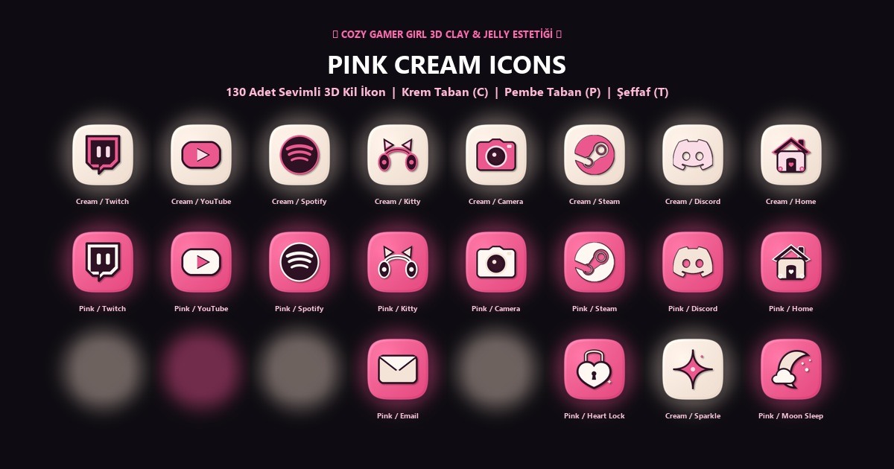

  
  <h1>Pink Cream Icons</h1>
  
<strong>Elgato Stream Deck ve evoX için 3D Sevimli Kil & Jel Squircle İkon Paketi (Krem, Pembe & Şeffaf Kesitler).</strong>

  

    <strong>Dil / Language:</strong> <a href="README.md"><strong>EN</strong></a> | <a href="README.tr.md"><strong>TR</strong></a>
    &nbsp;•&nbsp;
    <a href="https://github.com/Hfatih/pink-cream-icons/releases/latest">.evoxpack İndir</a> ·
    <a href="https://hfatih.github.io/pink-cream-icons/">Canlı İnteraktif Galeri</a> ·
    <a href="#nasil-kurulur">Nasıl Kurulur?</a>
  

  

    
    
    
    
    
    
  

  

    
    
    
    
    
  

---

  
  
<em>Sıcak Krem (C) ve Canlı Şeker Pembesi (P) tabanları ile masaüstü için şeffaf (T) kesitleri içeren 3D sevimli kil ikon koleksiyonu.</em>

---

## Genel Bakış

**Pink Cream Icons**, yayıncı ve oyuncu masaüstü kurulumlarında çok sevilen VivreMotion ve tatlı kil sanatından ilham alınarak **Elgato Stream Deck**, **evoXdeck**, **Loupedeck** ve **Touch Portal** için geliştirilmiştir.

Bombeli fildişi krem ve canlı çilek pembesi zeminler, 3D kil dokusu ve mürdüm/vişne kontrast detaylarıyla Stream Deck tuşlarınıza sıcacık bir hava katar.

### 🌐 Canlı İnteraktif Web Galerisi
Tüm ikonları tarayıcınızda canlı olarak test edin:  
👉 **[GitHub Pages Canlı Galerisini Aç](https://hfatih.github.io/pink-cream-icons/)**

---

## 🚀 Nasıl Kurulur?

### 1. evoX / evoXdeck (Tek Tıkla Kurulum)
1. [En Son Sürüm](https://github.com/Hfatih/pink-cream-icons/releases/latest) sayfasından **`Pink Cream Icons.evoxpack`** dosyasını indirin.
2. **evoXdeck** uygulamasını açıp dosyayı pencereye sürükleyin.

### 2. Elgato Stream Deck
1. Arşivdeki **`icons/`** klasörünü çıkartın.
2. Elgato Stream Deck yazılımında istediğiniz tuşa `Cream` veya `Pink` klasöründeki 144×144 PNG ikonunu sürükleyip bırakın.
