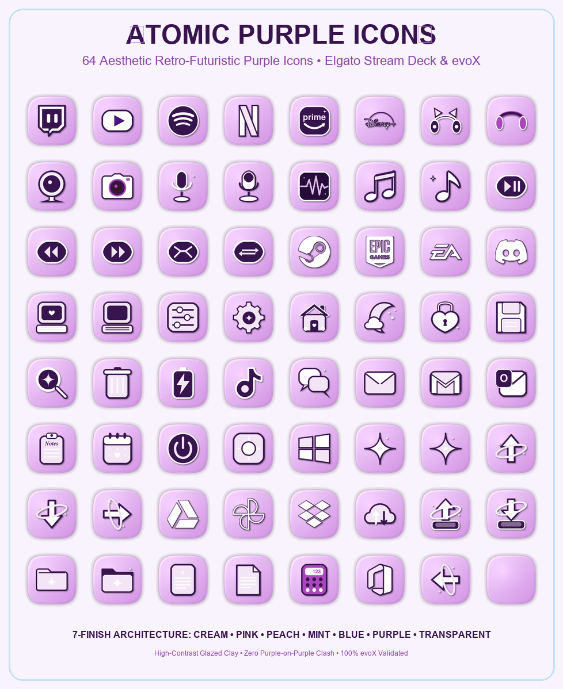
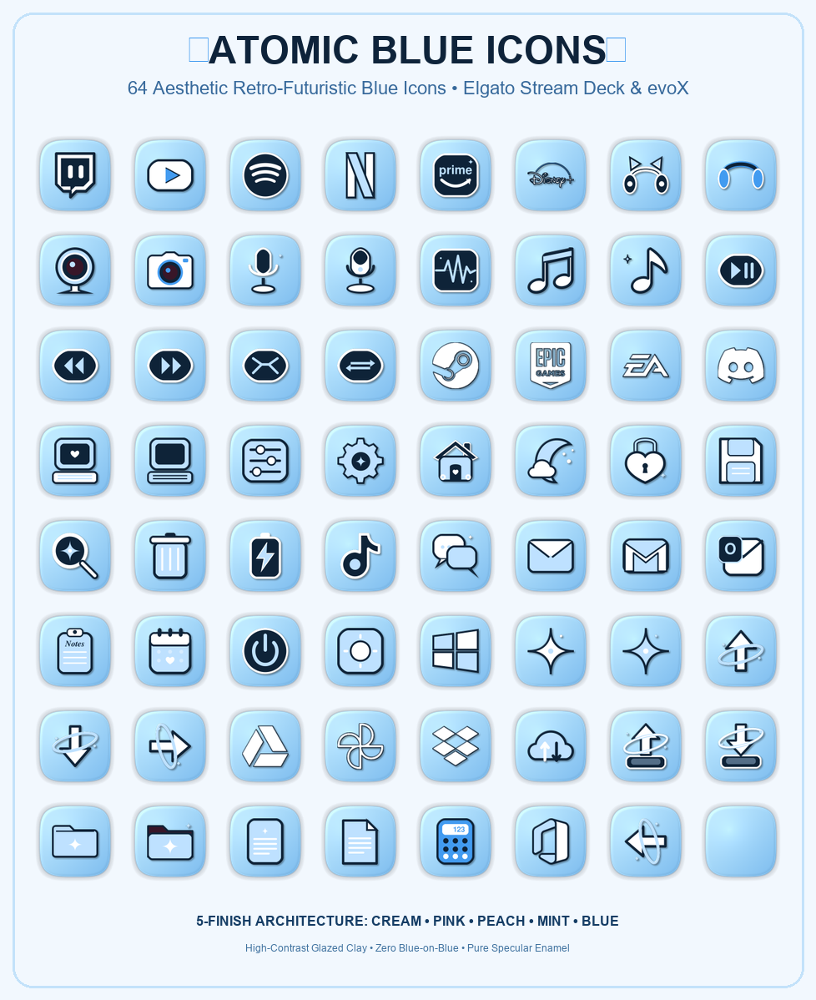
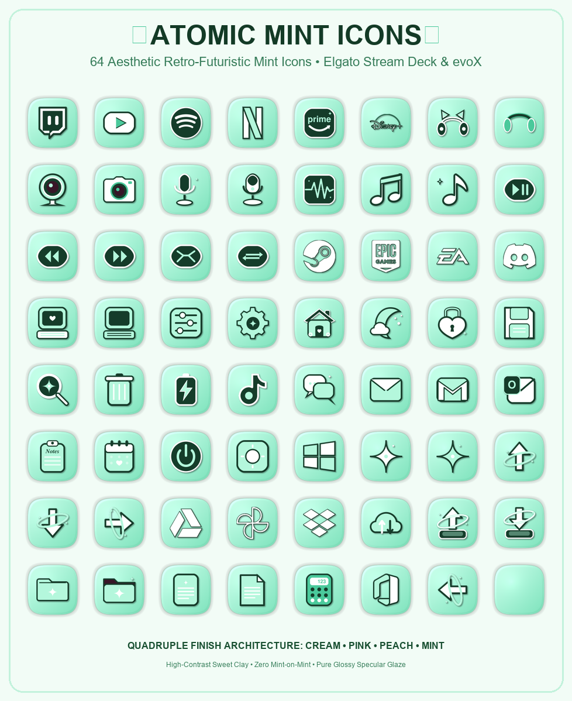
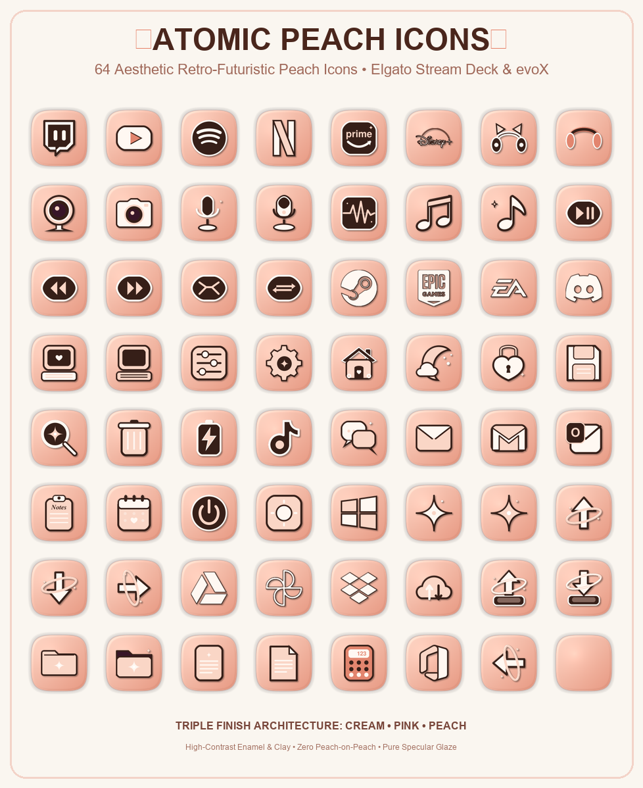

  
  <h1>Pink & Purple & Blue & Mint & Peach Icon Packs</h1>
  
<strong>Elgato Stream Deck ve evoX için 3D Sırlı Kil & Retro-Fütüristik Squircle İkon Koleksiyonu (448'lik Mega Paket + Bağımsız Atomic Serileri).</strong>

  

    <strong>Dil / Language:</strong> <a href="README.md"><strong>English</strong></a> | <a href="README.tr.md"><strong>Türkçe</strong></a>
    &nbsp;•&nbsp;
    <a href="https://github.com/Hfatih/pink-cream-icons/releases/latest">.evoxpack İndir</a> ·
    <a href="https://hfatih.github.io/pink-cream-icons/">Canlı İnteraktif Galeri</a> ·
    <a href="#nasil-kurulur">Nasıl Kurulur?</a>
  

  

    
    
    
    
    
    
    
  

  

    
    
    
    
    
  

---

## 🎨 Görsel Vitrinler

  <h3>🟣 Atomic Purple (Pastel Lavanta & Gümüş Bitişleri)</h3>
  
    
  <h3>🔵 Atomic Blue (Bebek Mavisi & Gümüş Bitişleri)</h3>
  
    
  <h3>🌿 Atomic Mint (Fıstık Nanesi & Gümüş Bitişleri)</h3>
  
    
  <h3>🍑 Atomic Peach (Kayısı Şeftali & Gümüş Bitişleri)</h3>
  
    
  <h3>🌸 Pink Cream (Şeker Pembesi & Sıcak Fildişi Krem Bitişleri)</h3>
  

---

## 📖 Genel Bakış

**Pink & Purple & Blue & Mint & Peach Icon Packs**, masaüstü yayıncı ve oyuncu ortamları için özel olarak geliştirilmiş 3D sırlı kil ve retro-fütüristik emaye squircle ikon paketidir. **Elgato Stream Deck**, **evoXdeck**, **Loupedeck** ve **Touch Portal** cihazlarıyla tam uyumludur.

VivreMotion kil sanatından, rüya gibi pastel tonlardan ve retro-fütüristik donanım tasarımlarından esinlenen her ikon, özel squircle geometrisi ($p=3.8, r=122$) ve $144\times 144$ Retina çözünürlüğünde 3D normal haritalama, ortam aydınlatması ve pürüzsüz yüzey yansımalarıyla hazırlanmıştır.

### 🌐 Canlı İnteraktif Web Galerisi
Tüm 448 ikonu tarayıcınızda 15 tuşlu sanal Stream Deck simülatöründe canlı olarak deneyin:  
👉 **[GitHub Pages Canlı Galerisini Aç](https://hfatih.github.io/pink-cream-icons/)**

---

## 🌟 5 İmza Renk Serisi ve Bitişler

> [!IMPORTANT]
> **Yüksek Kontrast Mimarisi:** Renk üstüne renk çakışmasını engellemek amacıyla tüm pastel tabanlarda (Mavi, Mor, Nane, Şeftali, Pembe) semboller saf inci beyazı (`#FFFFFF`) kabartma, yumuşak parıltı ve derin kontrastlı dış hatlarla çevrelenmiştir. Donanım tuşlarında her zaman jilet gibi net ve okunabilirdir.

| Renk Serisi | Taban Malzemesi | 3D Kabartma Sembol | Kontur ve Kontrast Detayları | Tema & Atmosfer |
| :--- | :--- | :--- | :--- | :--- |
| **🟣 Atomic Purple** | Masalsı pastel lavanta (`#EED2FA` ➔ `#CD8CE4`) | İnci beyazı (`#FFFFFF`) ve lavanta ışıltısı (`#F3E5F5`) | Derin patlıcan moru (`#38144F`) | Retro-fütüristik, synthwave, gece gökyüzü |
| **🔵 Atomic Blue** | Retro bebek mavisi (`#A0D3F4` ➔ `#78B9EE`) | İnci beyazı (`#FFFFFF`) ve buz mavisi ışıltı (`#BEE1FF`) | Derin gece mavisi (`#0E2338`) | Cyberpunk retro, berrak gökyüzü, buz camı |
| **🌿 Atomic Mint** | Yumuşak fıstık nanesi (`#B8EBD0` ➔ `#95DAB5`) | İnci beyazı (`#FFFFFF`) ve nane parlaklığı (`#D7F9E8`) | Derin zümrüt çam yeşili (`#133826`) | Ferahlatıcı botanik, yeşil çay estetiği |
| **🍑 Atomic Peach** | Sıcak kayısı şeftali (`#FDC8B0` ➔ `#FBA882`) | İnci beyazı (`#FFFFFF`) ve şeftali ışıltısı (`#FFE8DD`) | Sıcak pişmiş toprak / bronz (`#451A10`) | Gün batımı ışıltısı, sıcak ve samimi |
| **🌸 Candy Pink** | Canlı çilek şeker pembesi (`#F673A0` ➔ `#E4467D`) | Sıcak fildişi krem (`#FFF8F2`) ve açık pembe | Derin vişne mürdüm (`#2E1224`) | Gamer girl, tatlı şeker, neşeli pop |
| **🍦 Warm Cream** | Yumuşak fildişi krem (`#FDF1EA` ➔ `#EEDDCF`) | 3D canlı gül pembesi (`#EB588D`) ve mürdüm | Sol üst porselen cilası ve kenar ışığı | Sıcak kahve, minimalist, soft estetik |
| **⚪ Pearl / Gümüş** | Fırçalanmış metalik inci gümüş (`#FCF8FC` ➔ `#EEE1EE`)| 3D renkli kromatik kil semboller | Derin kromatik gölge (`#4A148C` / `#0E2338`) | Titanyum, modern lüks, fütüristik |
| **✨ Transparent** | Tabansız izole 3D kil kesiti | Tam 3D derinlikli alfa PNG | Masaüstü dock'ları için yumuşak gölgeli | Özel Stream Deck ve masaüstü dock'ları |

---

## 📂 6 Kategoride 64 Özel Sembol

Tüm renk serileri eksiksiz 64 ikonik sembolü içerir:

### 1. 📡 Yayın, Ses & Medya (20 İkon)
- **Platformlar:** Twitch, YouTube, Spotify, Netflix, Prime Video, Disney+.
- **Donanım:** Kedi Kulaklı Kulaklık, Stüdyo Kulaklığı, Web Kamerası, Retro Fotoğraf Makinesi, Stüdyo Mikrofonu, Masaüstü USB Mikrofon.
- **Müzik & Oynatma:** Ses Dalga Formu (Osilatör), Müzik Diski, Yıldızlı Nota, Oynat/Duraklat, Önceki Parça, Sonraki Parça, Karışık Çal, Tekrar Çal.

### 2. 🎮 Oyun & Başlatıcılar (4 İkon)
- **Platformlar:** Steam (Dişliler), Epic Games (Kalkan), EA App (Electronic Arts Amblemi), Discord (Clyde Kontrolcü Yüzü).

### 3. ⚙️ Sistem, Donanım & Kısayollar (11 İkon)
- **Masaüstü:** Retro Bilgisayar (Açık), Retro Bilgisayar (Uyku/Kapalı), Ayar Sürgüleri, Yıldızlı Ayarlar Çarkı, Sevimli Ev, Hilal Ay (Uyku), Kalpli Kilit, Disket (Kaydet), Büyüteç (Ara), Çöp Kutusu, Pil Göstergesi.

### 4. 💬 Sosyal Ağlar & İletişim (5 İkon)
- **İletişim:** TikTok, Sohbet Balonları, Parıltılı Mektup Zarfı, Gmail, Microsoft Outlook.

### 5. 📋 Üretkenlik, Dosya & Bulut (18 İkon)
- **Ofis:** Not Panosu, Kalpli Takvim, Güç Anahtarı, Parlaklık Güneşi, Windows 11.
- **Bulut Depolama:** Google Drive (Prizma), Google Fotoğraflar (Fırıldak), Dropbox (Açık Kutu), Bulut Senkronizasyon.
- **İş Akışı:** Yükleme Tepsisi (Upload), İndirme Tepsisi (Download), Kapalı Klasör, Yıldızlı Açık Klasör, Çizgili Belge, Köşesi Katlı Belge, Sevimli Hesap Makinesi, Microsoft 365 Office, Boş Squircle Tuş.

### 6. ✨ Estetik Vurgular & Yön Okları (6 İkon)
- **Yıldızlar & Oklar:** Pembe 4 Köşeli Yıldız (✦), Krem Yıldız (✦), Yukarı Yön Oku, Aşağı Yön Oku, Sağa Yön Oku, Sola Yön Oku.

---

## 📦 İndirilebilir Paketler (.evoxpack)

Tüm paketleri doğrudan **[En Son Sürüm](https://github.com/Hfatih/pink-cream-icons/releases/latest)** sayfasından indirebilirsiniz:

| Paket Adı | İkon Sayısı | Açıklama |
| :--- | :---: | :--- |
| **`Pink.Cream.Icons.evoxpack`** | **448 İkon** | **Ana Mega Koleksiyon:** 7 bitişin tamamını içeren ana paket (Krem 64, Pembe 64, Şeftali 64, Nane 64, Mavi 64, Mor 64, Şeffaf 64). |
| **`Atomic.Purple.Icons.evoxpack`** | **128 İkon** | Bağımsız Atomic Purple paketi (64 Pastel Lavanta + 64 Gümüş/İnci). |
| **`Atomic.Blue.Icons.evoxpack`** | **128 İkon** | Bağımsız Atomic Blue paketi (64 Bebek Mavisi + 64 Gümüş/İnci). |
| **`Atomic.Mint.Icons.evoxpack`** | **128 İkon** | Bağımsız Atomic Mint paketi (64 Fıstık Nanesi + 64 Gümüş/İnci). |
| **`Atomic.Peach.Icons.evoxpack`** | **128 İkon** | Bağımsız Atomic Peach paketi (64 Kayısı Şeftali + 64 Gümüş/İnci). |

---

## 🚀 Nasıl Kurulur?

### 1. evoX / evoXdeck (Önerilen - Tek Tıkla Kurulum)
1. **[Sürümler Sayfasından](https://github.com/Hfatih/pink-cream-icons/releases/latest)** istediğiniz `.evoxpack` dosyasını indirin.
2. **evoXdeck** uygulamasını açın.
3. `.evoxpack` dosyasını uygulama penceresine sürükleyip bırakın veya Paket Yöneticisi içerisinden içe aktarın.
4. Tüm ikonlar anında kategorilerine göre düzenlenip kullanıma hazır hale gelir!

### 2. Elgato Stream Deck
1. Depoyu veya sürüm arşivini indirin.
2. **Elgato Stream Deck** yazılımını açın.
3. İstediğiniz tuşu seçin.
4. `icons/` klasöründen dilediğiniz 144×144 PNG ikonunu tuşun üzerine sürükleyin.

### 3. Loupedeck & Touch Portal
1. PNG ikonlarını çıkartın.
2. Loupedeck veya Touch Portal uygulamasında ilgili klasörü gösterip butonlarınıza atayın.

---

## 📐 Teknik Özellikler

| Özellik | Değer |
| :--- | :--- |
| **Çözünürlük** | $144\times 144$ Piksel (Elgato Stream Deck yerel standardı) |
| **Örnekleme** | $288\times 288$ Alt-piksel render & Lanczos filtreleme |
| **Squircle Geometrisi** | $p = 3.8$ Süper elips |
| **Renk Modeli** | 32-bit RGBA PNG pürüzsüz alfa şeffaflığı |
| **evoX Uyumluluğu** | Resmi evoX Zod şeması ile %100 doğrulanmış |
| **Geliştirici** | [Fatih Han (Hfatih)](https://github.com/Hfatih) |
| **Lisans** | [MIT Lisansı](LICENSE) (Kişisel ve ticari yayınlarda ücretsiz) |

---

  
💖 <a href="https://github.com/Hfatih">Hfatih</a> tarafından tasarlandı

